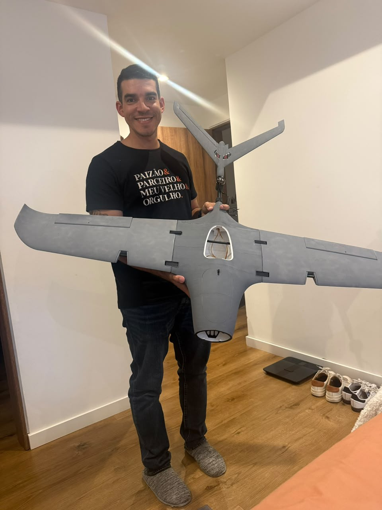
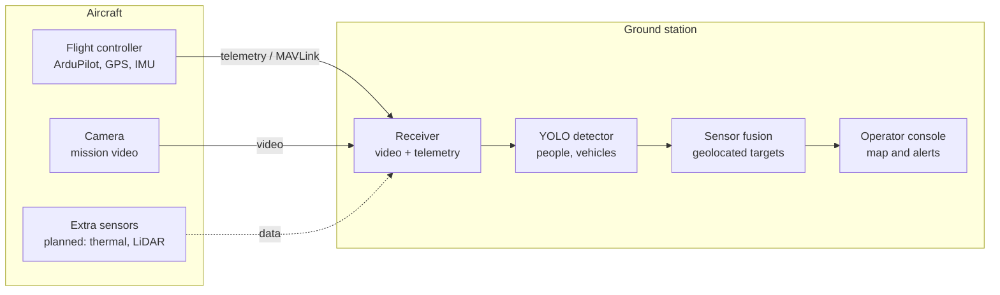

# Stallion VTOL Perception

**English** | [Português](README.pt-BR.md)

A 3D-printed fixed-wing VTOL UAV (Flightory Stallion) built as an aerial perception platform. The aircraft streams video and telemetry to a ground station, where an object detection model (YOLO) identifies trained classes such as people and vehicles. Later phases add geolocated detections and multi-sensor fusion.

Applications: tactical reconnaissance, search and rescue (SAR), survey of hazardous areas (e.g. humanitarian demining support), disaster monitoring and inspection.

## The problem

Reconnaissance drone operators have to find people and vehicles on the ground from RGB camera imagery, usually as live video, over long periods and often in poor light or bad weather. Small, camouflaged or partially hidden targets get missed, and operator fatigue grows with mission time.

Sensor fusion, backed by an AI model trained to recognize these patterns, gives the operator decisive support in tactical reconnaissance, search and rescue, survey of hazardous areas and disaster monitoring.

## Why it matters

Autonomous and human-operated systems will increasingly be employed together with AI, extending the operational reach of small teams well beyond what was possible before.

In practice, that means covering larger areas in less time, missing fewer targets and giving the operator the target's location, not just an image. In search and rescue, every minute saved raises the chance of finding a person alive.

## Limitations of current approaches

- **Night and low light:** RGB cameras lose most of their detection capability.
- **Small targets:** at altitude a person spans only a few pixels, and detectors trained on ground-level imagery (such as COCO) perform worse at that scale.
- **Motion:** fast targets and airframe vibration cause blur and lost tracks.
- **False positives:** shadows, rocks, vegetation and debris get mistaken for people or vehicles, and every false alarm has to be dismissed by the operator.
- **Adverse weather:** rain, fog, smoke and dust degrade the image.
- **Camouflage and occlusion:** targets under vegetation or partially covered.
- **Single sensor:** thermal cameras help at night but have low resolution, suffer from thermal crossover (target and background at the same temperature) and carry no color or texture.
- **Detection without location:** most solutions mark the target on screen but do not provide map coordinates.
- **Weight, power and link:** small platforms cannot carry heavy onboard compute, and the video downlink is limited by bandwidth and latency.
- **Operator workload:** hours of live video lead to fatigue and missed targets.

## How this project addresses them

- Fusing RGB with a second sensor (thermal or LiDAR) to keep detection working at night and in poor conditions.
- Running inference on the ground station, which allows larger models without adding weight to the aircraft.
- Fine-tuning on custom aerial imagery, focused on small targets seen from above.
- Tracking across frames to cut false positives and follow moving targets.
- Geolocation: every detection comes with latitude and longitude.
- Metrics measured and published at each phase.

## Status

| Phase | Description | Status |
| --- | --- | --- |
| 0 | Airframe: print, assembly and finishing | Done |
| 1 | Electrical system and flight (manual + VTOL tuning) | In progress |
| 2 | Video and telemetry downlink to the ground station | Planned |
| 3 | Ground-based object detection (pretrained YOLO) | Planned |
| 4 | Custom aerial dataset and fine-tuning | Planned |
| 5 | Geolocation of detections (lat, lon) | Planned |
| 6 | Sensor fusion and tracking | Planned |

Details and completion criteria for each phase: [ROADMAP.md](ROADMAP.md). Build log: [PROGRESS.md](PROGRESS.md).

## Platform

| Item | Value |
| --- | --- |
| Airframe | Flightory Stallion, VTOL version |
| Wingspan / length | 1,340 mm / 990 mm |
| VTOL layout | Tricopter: front tilt motor + fixed rear motors |
| Takeoff weight (AUW, published) | 2,000-3,000 g |
| Cruise speed (published) | 60-70 km/h |
| Material | LW-PLA; ASA for parts that need more strength and heat resistance |

## Components

Based on the Flightory specification. The list will be updated as parts are installed.

| Item | Choice |
| --- | --- |
| Flight controller | SpeedyBee F405 |
| GPS | Matek M10Q |
| Motors | EMAX |
| Camera | Moonlight with GM3 gimbal |
| Firmware | ArduPilot (QuadPlane, tilt-rotor) |

## Architecture

Inference runs on the ground station, not on board, which keeps the aircraft light and allows a larger model.

Planned software stack: ArduPilot, Mission Planner / QGroundControl, pymavlink or MAVROS, ROS 2, Python, PyTorch, Ultralytics YOLO, OpenCV.

## Metrics to report

- mAP@0.5 per class on a held-out aerial test set
- Inference FPS on the ground-station hardware
- End-to-end latency (camera to detection on screen)
- Geolocation error in meters against targets with known GPS coordinates
- Detection gain from sensor fusion versus camera only

## Safety

Test flights follow the local UAS regulations, in authorized areas, within visual line of sight and with failsafe (RTL on link loss) configured. Datasets published here will not contain identifiable people.

## Credits

Airframe design by [Flightory](https://flightory.com). Specifications from [SkyRaccoon](https://www.skyraccoon.com/aircraft/Flightory_Stallion-VTOL_stallion) and [DroneXL](https://dronexl.co/2025/04/04/3d-printed-stallion-drone-diy-fixed-wing/).

## Author

Bruno Barroso, M.S. in Artificial Intelligence student at the University of Colorado Boulder. [LinkedIn](https://www.linkedin.com/in/brunobarroso-ai/)
