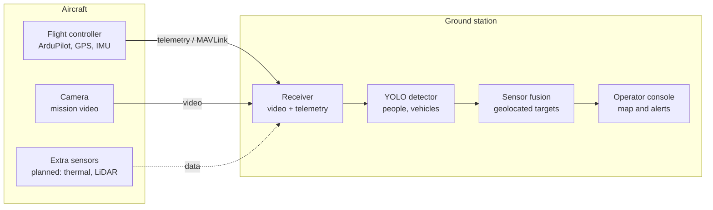

# Stallion VTOL Perception

**English** | [Português](README.pt-BR.md)

A 3D-printed fixed-wing VTOL UAV (Flightory Stallion) built as an aerial perception platform. The aircraft streams video and telemetry to a ground station, where an object detection model (YOLO) identifies trained classes such as people and vehicles. Later phases add geolocated detections and multi-sensor fusion.

Applications: tactical reconnaissance, search and rescue (SAR), survey of hazardous areas (e.g. humanitarian demining support), disaster monitoring and inspection.

## The problem

Reconnaissance drone operators have to find people and vehicles on the ground from RGB camera imagery, usually as live video, over long periods and often in poor light or bad weather. Small, camouflaged or partially hidden targets get missed, and operator fatigue grows with mission time.

Sensor fusion, backed by an AI model trained to recognize these patterns, gives the operator decisive support in tactical reconnaissance, search and rescue, survey of hazardous areas and disaster monitoring.

## Why it matters

Autonomous and human-operated systems will increasingly be employed together with AI, extending the operational reach of small teams well beyond what was possible before.

In practice, that means covering larger areas in less time, missing fewer targets and giving the operator the target's location, not just an image. In search and rescue, every minute saved raises the chance of finding a person alive.

## Limitations of current approaches

- **Night and low light:** RGB cameras lose most of their detection capability.
- **Small targets:** at altitude a person spans only a few pixels, and detectors trained on ground-level imagery (such as COCO) perform worse at that scale.
- **Motion:** fast targets and airframe vibration cause blur and lost tracks.
- **False positives:** shadows, rocks, vegetation and debris get mistaken for people or vehicles, and every false alarm has to be dismissed by the operator.
- **Adverse weather:** rain, fog, smoke and dust degrade the image.
- **Camouflage and occlusion:** targets under vegetation or partially covered.
- **Single sensor:** thermal cameras help at night but have low resolution, suffer from thermal crossover (target and background at the same temperature) and carry no color or texture.
- **Detection without location:** most solutions mark the target on screen but do not provide map coordinates.
- **Weight, power and link:** small platforms cannot carry heavy onboard compute, and the video downlink is limited by bandwidth and latency.
- **Operator workload:** hours of live video lead to fatigue and missed targets.

## How this project addresses them

- Fusing RGB with a second sensor (thermal or LiDAR) to keep detection working at night and in poor conditions.
- Running inference on the ground station, which allows larger models without adding weight to the aircraft.
- Fine-tuning on custom aerial imagery, focused on small targets seen from above.
- Tracking across frames to cut false positives and follow moving targets.
- Geolocation: every detection comes with latitude and longitude.
- Metrics measured and published at each phase.

## Potential contribution

- **An open, end-to-end reference pipeline:** airframe, flight stack, video/telemetry downlink, detection, tracking and geolocation, documented and reproducible on low-cost hardware.
- **Evidence under real constraints:** measured FPS, latency and geolocation error for published methods (slicing inference, RGB-thermal fusion, tracking) running on a hobby-grade VTOL and a ground station, not only on benchmark GPUs.
- **New aerial data:** a custom dataset from terrain and conditions underrepresented in public benchmarks, published without identifiable people.
- **Operator-centered output:** alerts with map coordinates instead of raw video, aimed at reducing workload in long missions.
- **Transferable lessons** for tactical reconnaissance, search and rescue, hazardous-area survey and disaster response.

## Related work

### Aerial datasets and benchmarks

| Work | What it provides | Similar to this project | Different |
| --- | --- | --- | --- |
| [VisDrone](https://arxiv.org/abs/2001.06303) (Zhu et al., 2020) | Large drone benchmark from 14 cities; detection, video detection and tracking tracks | Small objects seen from drones, people and vehicles | RGB only, urban scenes, mostly recorded footage |
| [HIT-UAV](https://arxiv.org/abs/2204.03245) (Suo et al., Scientific Data 2023) | 2,898 thermal images from 60-130 m; person, car, bicycle and other vehicles | Thermal detection of people and vehicles from altitude | Thermal only; no RGB pairing or onboard system |
| [DroneVehicle](https://arxiv.org/abs/2003.02437) (Sun et al.) | 28,439 RGB-infrared image pairs of vehicles | RGB + thermal fusion from drones | Vehicles only; offline detection |
| [WiSARD](https://arxiv.org/abs/2309.04453) (Broyles et al., IROS 2022) | ~56,000 labeled visual and thermal images for wilderness SAR | Multi-modal data for search and rescue | Dataset, not a deployed pipeline |
| [AIR on HERIDAL](https://arxiv.org/abs/2111.09406) (Pyrrö et al., 2021) | Person detection for land SAR; RetinaNet-based detector with box merging | Small people in large aerial images | RGB only; no tracking or geolocation |

### Detection methods for small aerial targets

| Work | Idea | How it relates |
| --- | --- | --- |
| [SAHI](https://arxiv.org/abs/2202.06934) (Akyon et al., 2022) | Slices large images into tiles for inference and fine-tuning; up to +14.5% AP on VisDrone/xView | Candidate for phases 3-4 to recover small targets; cost in FPS will be measured |
| [TPH-YOLOv5](https://arxiv.org/abs/2108.11539) (Zhu et al., ICCV Workshops 2021) | Extra small-object head, transformer prediction heads and attention; about 7% better than the YOLOv5 baseline on VisDrone | Shows the gains of small-object heads; this project starts from current Ultralytics YOLO and compares |

### RGB-thermal fusion

| Work | Idea | How it relates |
| --- | --- | --- |
| [UA-CMDet](https://arxiv.org/abs/2003.02437) (Sun et al.) | Weights each modality by illumination and uncertainty, then merges detections with illumination-aware NMS | Reference for phase 6 late fusion at night; this project tests it with people as well as vehicles |

### Tracking

| Work | Idea | How it relates |
| --- | --- | --- |
| [ByteTrack](https://arxiv.org/abs/2110.06864) (Zhang et al., ECCV 2022) | Associates low-score boxes to existing tracks to recover occluded objects; 80.3 MOTA on MOT17 at ~30 FPS | Planned tracker in phase 6 to reduce false positives and keep moving targets |

### Target geolocation from a UAV

| Work | Idea | How it relates |
| --- | --- | --- |
| [Pan et al., Drones 2023](https://www.mdpi.com/2504-446X/7/2/87) | Monocular multi-view triangulation of moving targets; about 2.9 m error at 50 m altitude in simulation | Baseline for phase 5; this project starts with single-view projection from telemetry and terrain, then compares |

### Platforms and tools

[ArduPilot](https://ardupilot.org) (QuadPlane), [Ultralytics YOLO](https://docs.ultralytics.com), [ROS 2](https://docs.ros.org) and MAVLink are the open-source building blocks; the airframe is the [Flightory Stallion](https://flightory.com).

### How this project builds on prior work

- **Reuses:** public datasets for pretraining and comparison (VisDrone, HIT-UAV, WiSARD), SAHI for small targets, ByteTrack for tracking and ArduPilot for flight control.
- **Compares:** each method against a plain YOLO baseline on the same data, reporting accuracy and cost (FPS, latency) side by side.
- **Extends:** joins detection, fusion, tracking and geolocation in one system flying on low-cost hardware, where most works study one stage offline.
- **Adds new knowledge:** measurements in real flight, a custom aerial dataset and open documentation of what worked and what did not.

## Status

| Phase | Description | Status |
| --- | --- | --- |
| 0 | Airframe: print, assembly and finishing | Done |
| 1 | Electrical system and flight (manual + VTOL tuning) | In progress |
| 2 | Video and telemetry downlink to the ground station | Planned |
| 3 | Ground-based object detection (pretrained YOLO) | Planned |
| 4 | Custom aerial dataset and fine-tuning | Planned |
| 5 | Geolocation of detections (lat, lon) | Planned |
| 6 | Sensor fusion and tracking | Planned |

Details and completion criteria for each phase: [ROADMAP.md](ROADMAP.md). Build log: [PROGRESS.md](PROGRESS.md).

## Platform

| Item | Value |
| --- | --- |
| Airframe | Flightory Stallion, VTOL version |
| Wingspan / length | 1,340 mm / 990 mm |
| VTOL layout | Tricopter: front tilt motor + fixed rear motors |
| Takeoff weight (AUW, published) | 2,000-3,000 g |
| Cruise speed (published) | 60-70 km/h |
| Material | LW-PLA; ASA for parts that need more strength and heat resistance |

## Components

Based on the Flightory specification. The list will be updated as parts are installed.

| Item | Choice |
| --- | --- |
| Flight controller | SpeedyBee F405 |
| GPS | Matek M10Q |
| Motors | EMAX |
| Camera | Moonlight with GM3 gimbal |
| Firmware | ArduPilot (QuadPlane, tilt-rotor) |

## Architecture

Inference runs on the ground station, not on board, which keeps the aircraft light and allows a larger model.

Planned software stack: ArduPilot, Mission Planner / QGroundControl, pymavlink or MAVROS, ROS 2, Python, PyTorch, Ultralytics YOLO, OpenCV.

## Metrics to report

- mAP@0.5 per class on a held-out aerial test set
- Inference FPS on the ground-station hardware
- End-to-end latency (camera to detection on screen)
- Geolocation error in meters against targets with known GPS coordinates
- Detection gain from sensor fusion versus camera only

## Safety

Test flights follow the local UAS regulations, in authorized areas, within visual line of sight and with failsafe (RTL on link loss) configured. Datasets published here will not contain identifiable people.

## Credits

Airframe design by [Flightory](https://flightory.com). Specifications from [SkyRaccoon](https://www.skyraccoon.com/aircraft/Flightory_Stallion-VTOL_stallion) and [DroneXL](https://dronexl.co/2025/04/04/3d-printed-stallion-drone-diy-fixed-wing/).

## Author

Bruno Barroso, M.S. in Artificial Intelligence student at the University of Colorado Boulder. [LinkedIn](https://www.linkedin.com/in/brunobarroso-ai/)
