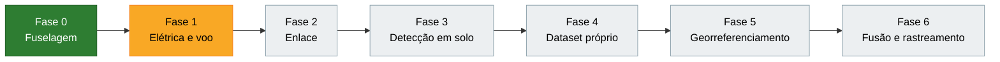
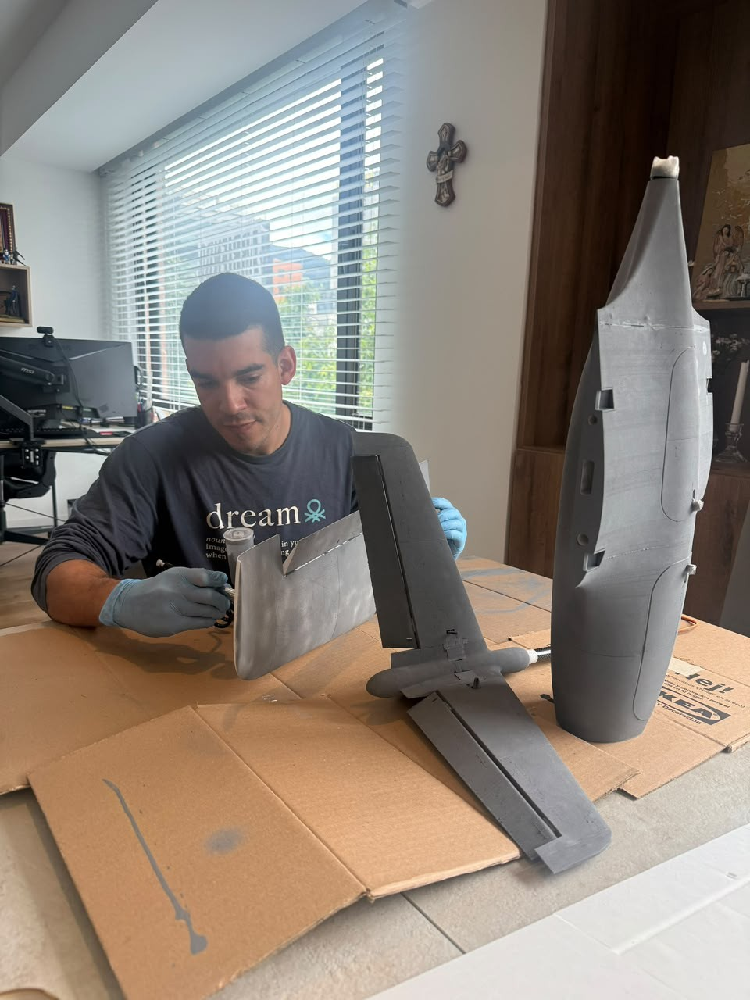

# Stallion VTOL Perception

[English](README.md) | **Português**

VANT de asa fixa VTOL impresso em 3D (Flightory Stallion), construído como plataforma de percepção aérea. A aeronave transmite vídeo e telemetria para uma estação terrestre, onde um modelo de detecção de objetos (YOLO) identifica as classes treinadas, como pessoas e veículos. As fases seguintes acrescentam detecções georreferenciadas e fusão de sensores.

Aplicações: reconhecimento tático, busca e salvamento (SAR), levantamento de áreas de risco (por exemplo, apoio à desminagem humanitária), monitoramento de desastres e inspeção.

## O problema

Operadores de drones de reconhecimento precisam encontrar pessoas e veículos no solo usando imagens de câmeras RGB, quase sempre em vídeo ao vivo, por longos períodos e muitas vezes com pouca luz ou clima ruim. Alvos pequenos, camuflados ou parcialmente encobertos passam despercebidos, e a fadiga do operador cresce com o tempo de missão.

A fusão de sensores, apoiada por um modelo de IA treinado para reconhecer esses padrões, dá ao operador um apoio decisivo em reconhecimento tático, busca e salvamento, levantamento de áreas de risco e monitoramento de desastres.

## Por que é importante

Sistemas autônomos e sistemas operados por pessoas serão empregados cada vez mais em conjunto com IA, ampliando a capacidade operacional de equipes pequenas a um nível que antes não era possível.

Na prática, isso significa varrer áreas maiores em menos tempo, perder menos alvos e entregar ao operador a localização do alvo, e não apenas a imagem. Em uma busca e salvamento, cada minuto economizado aumenta a chance de encontrar a pessoa com vida.

## Limitações das soluções atuais

- **Noite e pouca luz:** câmeras RGB perdem quase toda a capacidade de detecção.
- **Alvos pequenos:** em altitude, uma pessoa ocupa poucos pixels, e detectores treinados com imagens ao nível do solo (como o COCO) erram mais nessa escala.
- **Movimento:** alvos rápidos e a vibração da aeronave geram borrão e perda de rastreamento.
- **Falsos positivos:** sombras, rochas, vegetação e entulho são confundidos com pessoas ou veículos, e cada alarme falso precisa ser descartado pelo operador.
- **Clima adverso:** chuva, neblina, fumaça e poeira degradam a imagem.
- **Camuflagem e oclusão:** alvos sob vegetação ou parcialmente encobertos.
- **Sensor único:** a câmera térmica resolve parte do problema à noite, mas tem baixa resolução, sofre com o cruzamento térmico (quando alvo e fundo ficam na mesma temperatura) e não mostra cor nem textura.
- **Detecção sem localização:** a maioria das soluções aponta o alvo na tela, mas não entrega a coordenada no mapa.
- **Peso, energia e enlace:** plataformas pequenas não carregam computação embarcada pesada, e o vídeo transmitido sofre com banda e latência.
- **Carga do operador:** horas de vídeo ao vivo levam à fadiga e a alvos perdidos.

## Como o projeto aborda esses pontos

- Fusão do RGB com um segundo sensor (térmico ou LiDAR) para manter a detecção à noite e em condições ruins.
- Inferência na estação terrestre, o que permite modelos maiores sem pesar a aeronave.
- Fine-tuning com imagens aéreas próprias, focado em alvos pequenos vistos de cima.
- Rastreamento entre quadros para reduzir falsos positivos e acompanhar alvos em movimento.
- Georreferenciamento: cada detecção sai com latitude e longitude.
- Métricas medidas e publicadas a cada fase.

## Contribuição potencial

- **Um pipeline de referência aberto, de ponta a ponta:** fuselagem, controle de voo, enlace de vídeo e telemetria, detecção, rastreamento e georreferenciamento, documentados e reproduzíveis em hardware de baixo custo.
- **Evidência sob restrições reais:** FPS, latência e erro de georreferenciamento medidos para métodos publicados (inferência por recortes, fusão RGB-térmico, rastreamento) rodando em um VTOL de baixo custo e numa estação terrestre, e não só em GPUs de benchmark.
- **Dados aéreos novos:** um dataset próprio, de terrenos e condições pouco representados nos benchmarks públicos, publicado sem pessoas identificáveis.
- **Saída pensada para o operador:** alertas com coordenadas no mapa em vez de vídeo bruto, para reduzir a carga em missões longas.
- **Lições aplicáveis** a reconhecimento tático, busca e salvamento, levantamento de áreas de risco e resposta a desastres.

## Trabalhos relacionados

As tabelas comparativas completas, com links, estão no [README em inglês](README.md#related-work). Resumo por categoria:

- **Datasets e benchmarks aéreos:** [VisDrone](https://arxiv.org/abs/2001.06303) (RGB, cidades, detecção e rastreamento), [HIT-UAV](https://arxiv.org/abs/2204.03245) (2.898 imagens térmicas a 60-130 m), [DroneVehicle](https://arxiv.org/abs/2003.02437) (28.439 pares RGB-infravermelho de veículos), [WiSARD](https://arxiv.org/abs/2309.04453) (~56 mil imagens visuais e térmicas para busca e salvamento) e [AIR no HERIDAL](https://arxiv.org/abs/2111.09406) (detecção de pessoas em busca e salvamento). Parecidos por tratarem de alvos pequenos vistos de cima; diferentes por serem dados ou detecção offline, quase sempre com um único sensor e sem georreferenciamento.
- **Detecção de alvos pequenos:** [SAHI](https://arxiv.org/abs/2202.06934) (inferência por recortes, até +14,5% de AP no VisDrone/xView) e [TPH-YOLOv5](https://arxiv.org/abs/2108.11539) (cabeças para objetos pequenos e atenção). Serão testados nas fases 3 e 4, medindo o custo em FPS.
- **Fusão RGB-térmico:** [UA-CMDet](https://arxiv.org/abs/2003.02437) pondera cada modalidade pela iluminação e pela incerteza. É a referência da fase 6, aqui aplicada também a pessoas.
- **Rastreamento:** [ByteTrack](https://arxiv.org/abs/2110.06864) (80,3 MOTA no MOT17 a ~30 FPS) recupera alvos ocultos usando detecções de baixa confiança. Rastreador previsto na fase 6.
- **Georreferenciamento de alvos:** [Pan et al., Drones 2023](https://www.mdpi.com/2504-446X/7/2/87) triangulam alvos em movimento com câmera monocular (erro de ~2,9 m a 50 m de altitude em simulação). Linha de base da fase 5.
- **Plataformas e ferramentas:** [ArduPilot](https://ardupilot.org), [Ultralytics YOLO](https://docs.ultralytics.com), [ROS 2](https://docs.ros.org) e MAVLink; fuselagem [Flightory Stallion](https://flightory.com).

### Como o projeto se apoia nesses trabalhos

- **Reaproveita:** datasets públicos para pré-treino e comparação (VisDrone, HIT-UAV, WiSARD), SAHI para alvos pequenos, ByteTrack para rastreamento e ArduPilot para o controle de voo.
- **Compara:** cada método contra um YOLO de base nos mesmos dados, mostrando lado a lado precisão e custo (FPS e latência).
- **Amplia:** une detecção, fusão, rastreamento e georreferenciamento em um único sistema voando em hardware de baixo custo, enquanto a maioria dos trabalhos estuda uma etapa isolada e offline.
- **Gera conhecimento novo:** medições em voo real, um dataset aéreo próprio e documentação aberta do que funcionou e do que não funcionou.

## Status

| Fase | Descrição | Status |
| --- | --- | --- |
| 0 | Fuselagem: impressão, montagem e acabamento | Concluída |
| 1 | Sistema elétrico e voo (manual + ajuste VTOL) | Em andamento |
| 2 | Enlace de vídeo e telemetria com a estação terrestre | Planejada |
| 3 | Detecção de objetos em solo (YOLO pré-treinado) | Planejada |
| 4 | Dataset aéreo próprio e fine-tuning | Planejada |
| 5 | Georreferenciamento das detecções (lat, lon) | Planejada |
| 6 | Fusão de sensores e rastreamento | Planejada |

Detalhes e critérios de conclusão de cada fase: [ROADMAP.md](ROADMAP.md). Diário de construção: [PROGRESS.md](PROGRESS.md). Linha do tempo e discussão por fase: [Linha do tempo e discussão](#linha-do-tempo-e-discussão).

## Plataforma

| Item | Valor |
| --- | --- |
| Fuselagem | Flightory Stallion, versão VTOL |
| Envergadura / comprimento | 1.340 mm / 990 mm |
| Layout VTOL | Tricóptero: motor dianteiro basculante + motores traseiros fixos |
| Peso de decolagem (AUW, publicado) | 2.000-3.000 g |
| Velocidade de cruzeiro (publicada) | 60-70 km/h |
| Material | LW-PLA; ASA nas peças que pedem mais resistência e tolerância ao calor |

## Componentes

Baseados na especificação da Flightory. A lista será atualizada conforme a instalação.

| Item | Escolha |
| --- | --- |
| Controladora de voo | SpeedyBee F405 |
| GPS | Matek M10Q |
| Motores | EMAX |
| Câmera | Moonlight com gimbal GM3 |
| Firmware | ArduPilot (QuadPlane, tilt-rotor) |

## Arquitetura

A inferência roda na estação terrestre, não a bordo. Assim a aeronave fica leve e o modelo pode ser maior. O diagrama está no [README em inglês](README.md#architecture).

Stack de software previsto: ArduPilot, Mission Planner / QGroundControl, pymavlink ou MAVROS, ROS 2, Python, PyTorch, Ultralytics YOLO, OpenCV.

## Como o sistema funciona

### Fluxo da missão

1. **Planejamento:** o operador desenha a área de busca no Mission Planner ou no QGroundControl e gera um padrão de varredura. Altitude e espaçamento entre as linhas são escolhidos para que uma pessoa ainda ocupe pixels suficientes para ser detectada.
2. **Decolagem e deslocamento:** decolagem VTOL, transição para voo de asa fixa e execução da varredura em velocidade de cruzeiro.
3. **A bordo:** a câmera estabilizada pelo gimbal grava o vídeo enquanto a controladora registra posição (GPS), atitude (IMU) e ângulos do gimbal. Vídeo e telemetria MAVLink são transmitidos para a estação terrestre.
4. **Sincronização:** cada quadro de vídeo recebe um horário e é pareado com a telemetria do mesmo instante (interpolada). A 60-70 km/h a aeronave anda cerca de 1,8 m a cada 100 ms, então o alinhamento no tempo afeta diretamente a precisão do georreferenciamento.
5. **Detecção:** o modelo YOLO processa cada quadro (opcionalmente em recortes com SAHI, para alvos pequenos) e devolve caixas, classes e confiança.
6. **Rastreamento:** o ByteTrack liga as detecções entre quadros e dá um ID a cada alvo. O alvo só é confirmado depois de aparecer em vários quadros seguidos, o que filtra alarmes falsos isolados.
7. **Fusão (fase 6):** as detecções do RGB e do térmico (ou LiDAR) são combinadas, com mais peso para a modalidade que funciona melhor na luz do momento.
8. **Georreferenciamento:** um raio sai da câmera pelo centro de cada caixa confirmada, usando posição e atitude da aeronave, ângulos do gimbal e calibração da câmera, e é cruzado com o solo (primeiro terreno plano, depois um modelo de elevação). O resultado é latitude, longitude e uma estimativa de incerteza.
9. **Console do operador:** cada alvo aparece como um marcador no mapa, com o recorte da imagem, a classe, a confiança e o horário. O operador confirma ou descarta, e essa resposta é guardada para melhorar o dataset.
10. **Retorno e registro:** RTL e pouso. Vídeo, telemetria e detecções ficam salvos para análise pós-missão e avaliação.

### Módulos de software

| Módulo | Entrada | Saída | Ferramentas principais |
| --- | --- | --- | --- |
| Controle de voo | Missão, sensores | Voo estável, telemetria | ArduPilot (QuadPlane) |
| Receptor de vídeo | Sinal do enlace | Quadros com horário | OpenCV / GStreamer |
| Ponte de telemetria | MAVLink | Posição e atitude por instante | pymavlink ou MAVROS |
| Detector | Quadros | Caixas, classes, confiança | Ultralytics YOLO, SAHI |
| Rastreador | Detecções ao longo do tempo | Trilhas com ID | ByteTrack |
| Fusão (fase 6) | Detecções RGB + térmico/LiDAR | Detecções fundidas | Fusão tardia, depois fusão aprendida |
| Georreferenciamento | Trilhas + posição + calibração | Lat, lon, incerteza | Modelo de câmera + terreno |
| Console do operador | Alvos georreferenciados | Mapa, alertas, resposta do operador | ROS 2 / mapa web |

### Modos de operação

- **Assistido:** o operador acompanha o vídeo e o sistema destaca os candidatos.
- **Só alertas:** o operador acompanha o mapa e recebe apenas alvos confirmados e georreferenciados.

## Avaliação

### Dados

- **Datasets públicos** para pré-treino e comparação: VisDrone (RGB), HIT-UAV (térmico) e WiSARD (RGB + térmico, busca e salvamento).
- **Dataset próprio**, dos voos deste projeto, dividido em treino, validação e teste **por voo**: quadros de um mesmo voo nunca aparecem no treino e no teste ao mesmo tempo, o que evita resultados inflados.
- O conjunto de teste é estratificado por altitude, horário (dia, crepúsculo, noite) e tipo de terreno.

### Linhas de base e comparações

Toda melhoria é medida contra a mesma referência: um YOLO pré-treinado, sem alterações. Cada etapa nova entra por cima e é comparada:

1. YOLO pré-treinado (linha de base)
2. + fine-tuning com dados aéreos próprios
3. + inferência por recortes (SAHI)
4. + rastreamento (ByteTrack)
5. + fusão RGB-térmico

### Métricas

| Nível | Métrica | O que mostra |
| --- | --- | --- |
| Detecção | Precisão, recall, mAP@0.5 e mAP@0.5:0.95 por classe | Qualidade do detector |
| Detecção | Recall por tamanho do alvo (pequeno, médio, grande) | Desempenho em alvos pequenos vistos do alto |
| Rastreamento | MOTA, IDF1, trocas de ID | Estabilidade das trilhas |
| Sistema | FPS na estação terrestre | Capacidade de tempo real |
| Sistema | Latência ponta a ponta (captura até o alerta) | Utilidade operacional |
| Sistema | Alarmes falsos por minuto de voo | Carga do operador |
| Georreferenciamento | Erro médio e erro do percentil 95 (m) | Precisão das coordenadas do alvo |
| Missão | Tempo até a primeira detecção, percentual de alvos encontrados, área coberta por minuto | Valor numa busca real |

### Protocolo de teste em voo

- Alvos (pessoas e veículos) posicionados em pontos levantados com GPS, em área autorizada.
- Passagens repetidas em várias altitudes, de dia e à noite, com pelo menos três voos por condição.
- Cada voo registra vídeo, telemetria, detecções e a verdade de campo, para que os resultados possam ser recalculados depois.

### Metas iniciais por fase

Valores de partida, a serem revistos depois das primeiras medições.

| Fase | Métrica | Meta inicial |
| --- | --- | --- |
| 2 | Latência do vídeo até a estação terrestre | ≤ 300 ms |
| 3 | Taxa de detecção na estação terrestre | ≥ 15 FPS |
| 3 | Latência ponta a ponta (captura até o alerta) | ≤ 500 ms |
| 4 | mAP@0.5 no conjunto de teste próprio | ≥ 10 pontos acima da linha de base |
| 5 | Erro de georreferenciamento (percentil 95) a ~100 m de altitude | ≤ 10 m |
| 6 | Recall noturno em relação ao RGB sozinho | ganho relativo ≥ 20% |
| 6 | Alarmes falsos | ≤ 1 por minuto de voo |

### Ablação e publicação dos resultados

- Cada componente (fine-tuning, SAHI, rastreamento, fusão) é retirado um de cada vez para medir sua contribuição.
- Os resultados são publicados neste repositório ao fim de cada fase, incluindo o que não funcionou.

## Linha do tempo e discussão

Esta seção é atualizada a cada fase concluída: o que foi feito, quais foram os resultados, o que deu errado, o que foi decidido e o que vem a seguir. As datas são registradas conforme as fases terminam.

| Fase | Status | Concluída | Resultado principal |
| --- | --- | --- | --- |
| 0 - Fuselagem | Concluída | 2026-10 | Fuselagem impressa, montada e pintada |
| 1 - Elétrica e voo | Em andamento | - | - |
| 2 - Enlace | Planejada | - | - |
| 3 - Detecção em solo | Planejada | - | - |
| 4 - Dataset próprio | Planejada | - | - |
| 5 - Georreferenciamento | Planejada | - | - |
| 6 - Fusão e rastreamento | Planejada | - | - |

### Fase 0 - Fuselagem (concluída em 2026-10)

- **Feito:** todas as peças impressas; fuselagem, asas e cauda em V montadas e pintadas.
- **Decisões:** LW-PLA pelo baixo peso; ASA nas peças que pedem mais resistência e tolerância ao calor. Componentes seguem a especificação da Flightory.
- **Próximo passo:** fechar a lista de componentes (ESCs, rádio, bateria, modelo exato dos motores) e começar a instalação elétrica.

### Fase 1 - Sistema elétrico e voo (em andamento)

- **Objetivo:** transições estáveis entre o voo VTOL e o de asa fixa.
- **Pontos em aberto:** lista final de componentes; escolha do enlace de vídeo, que define a qualidade da imagem que chega ao detector.

<!-- Modelo para as próximas entradas:
### Fase N - Nome (concluída em AAAA-MM)
- Feito:
- Resultados (métricas):
- Problemas e como foram resolvidos:
- Decisões:
- Próximo passo:
-->

## Conclusão

### Resumo

O Stallion VTOL Perception transforma uma fuselagem VTOL de baixo custo, impressa em 3D, em uma plataforma de percepção aérea: vídeo e telemetria seguem para uma estação terrestre, onde detecção, rastreamento, fusão de sensores e georreferenciamento transformam imagens brutas em alvos confirmados no mapa. O projeto está na fase 1; esta seção será completada conforme as próximas fases forem concluídas.

### Galeria

| Acabamento das peças impressas em 3D | Fuselagem montada |
| --- | --- |
|  |  |

Imagens de voo, GIFs das detecções e capturas do mapa serão adicionados aqui a cada fase concluída.

### Principais resultados

Serão escritos ao fim da avaliação: resultados medidos em comparação com as metas iniciais, a contribuição de cada componente (ablação) e as principais lições dos testes em voo.

### Trabalhos futuros

- **Inferência embarcada (edge):** rodar o detector na própria aeronave (por exemplo, NVIDIA Jetson com TensorRT) para depender menos do enlace de vídeo.
- **Resposta autônoma às detecções:** orbitar ou refazer a varredura sobre um alvo confirmado sem comando do operador.
- **Busca com várias aeronaves:** dividir a área entre vários VANTs e juntar as detecções em um único mapa.
- **Percepção mais rica:** segmentação e modelos de visão e linguagem para descrever a cena, não apenas marcar caixas.
- **Agente de IA de apoio à missão:** um assistente que planeja as varreduras, prioriza os alertas e redige o relatório da missão.
- **Publicação do dataset:** disponibilizar o dataset aéreo próprio (sem pessoas identificáveis) como benchmark.

## Segurança

Os voos de teste seguem a regulamentação local de UAS, em área autorizada, em linha de visada e com failsafe (RTL na perda de link) configurado. Os datasets publicados aqui não terão pessoas identificáveis.

## Créditos

Projeto da fuselagem: [Flightory](https://flightory.com).

## Autor

Bruno Barroso, mestrando em Inteligência Artificial na University of Colorado Boulder. [LinkedIn](https://www.linkedin.com/in/brunobarroso-ai/)
